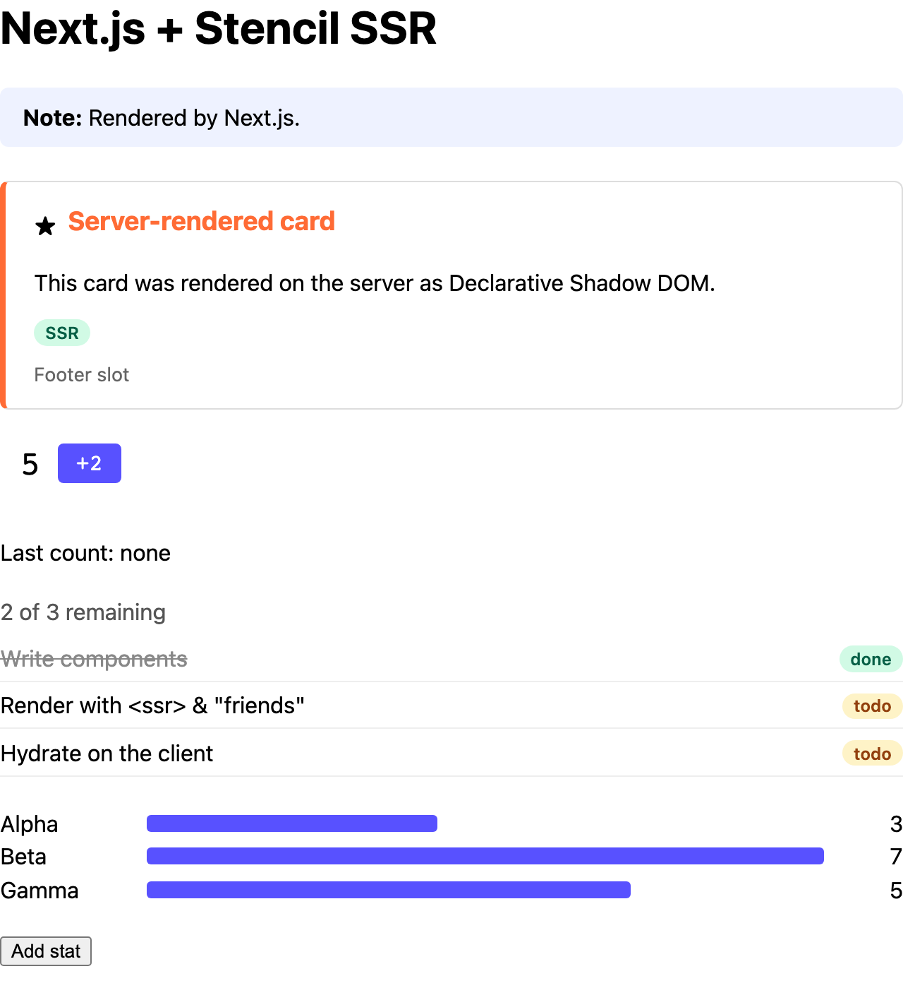
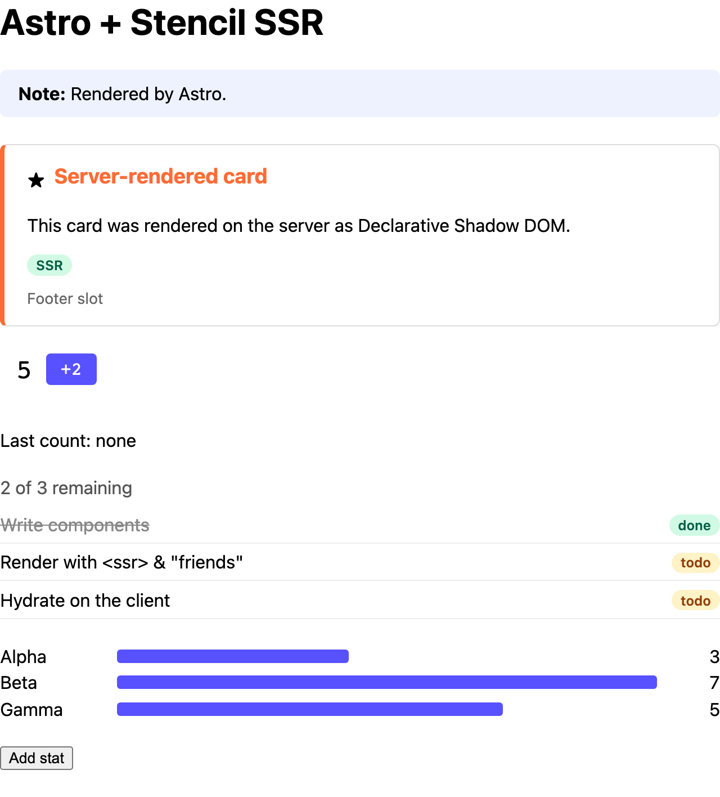
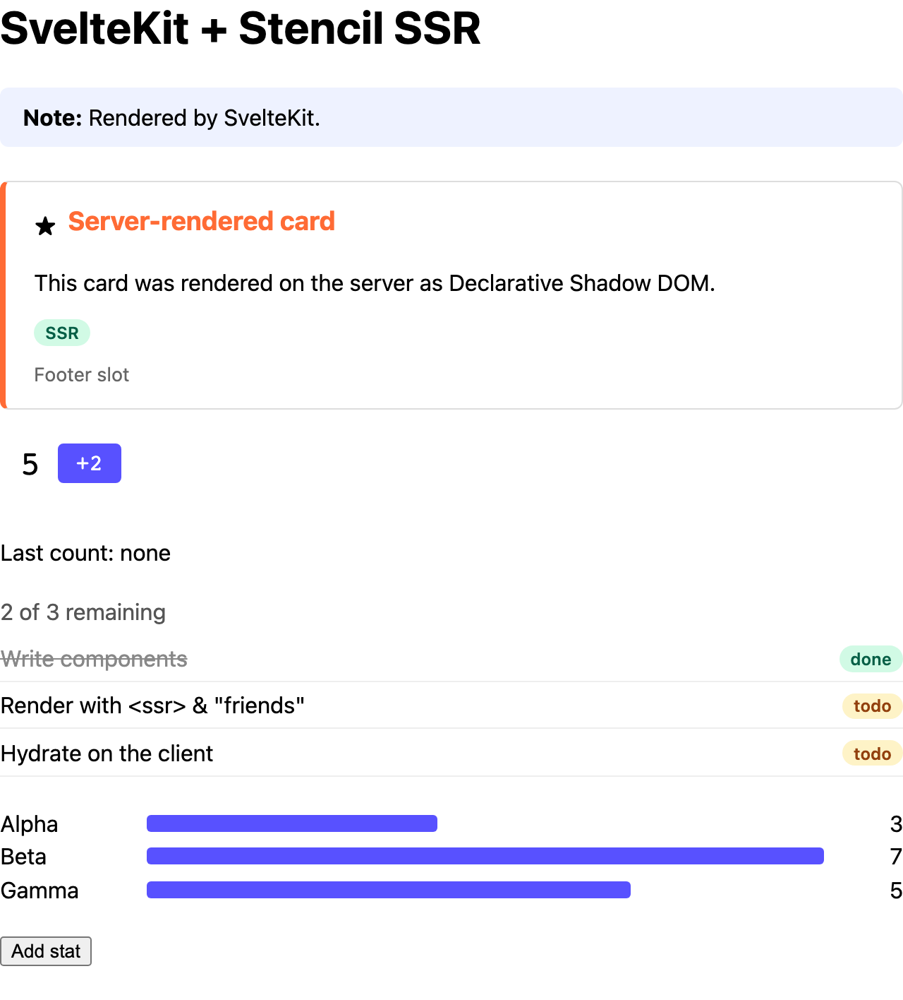
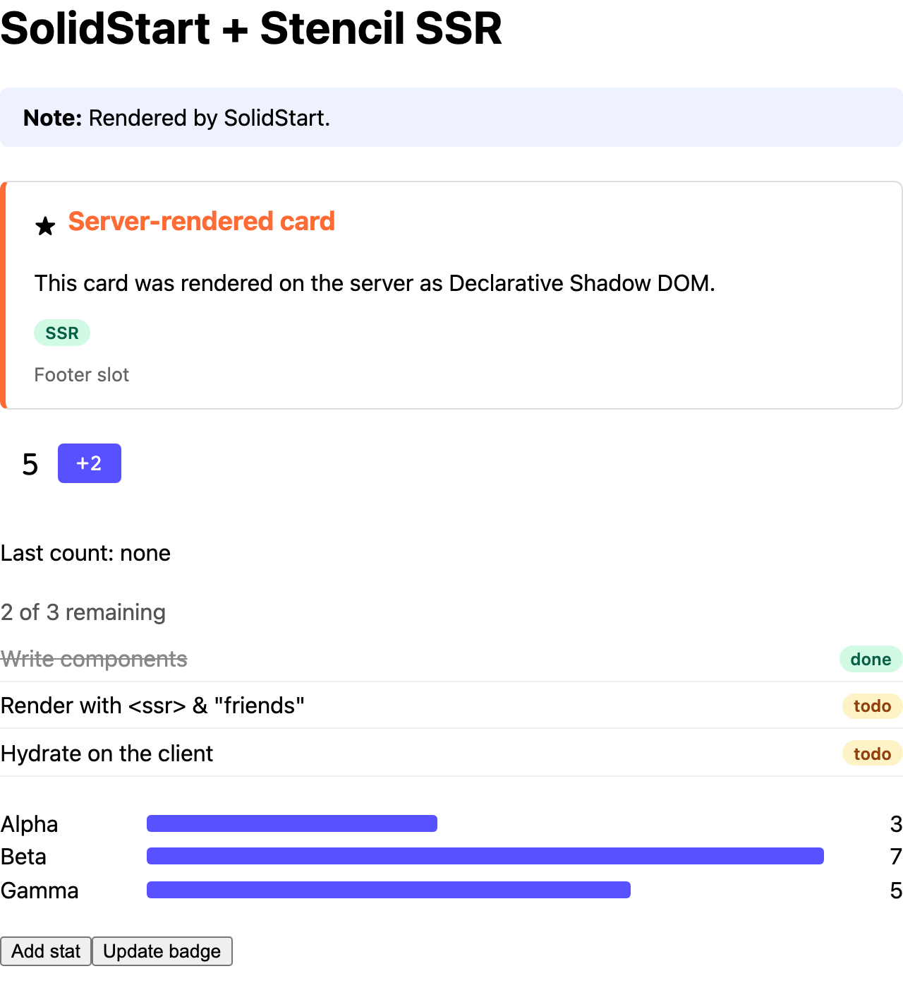
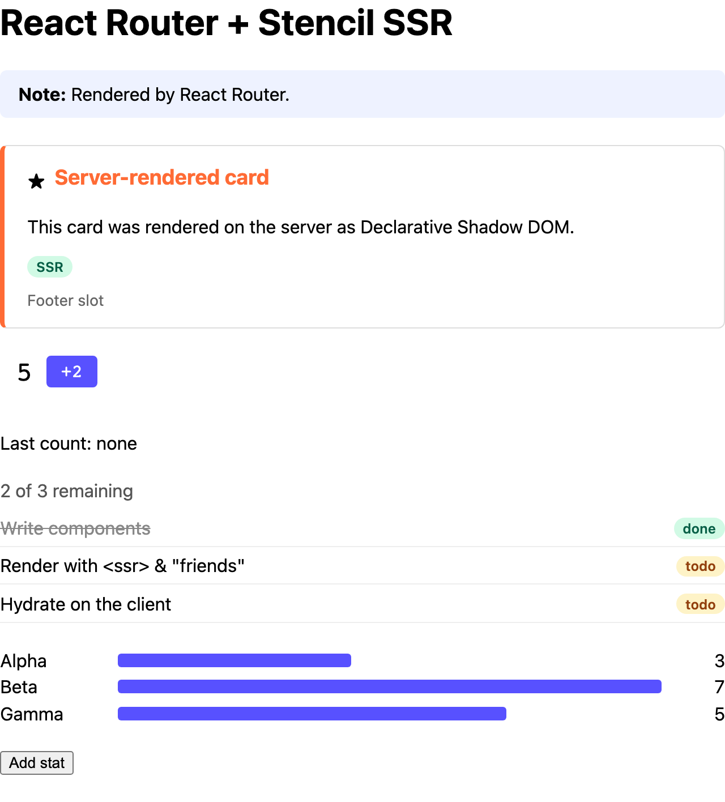
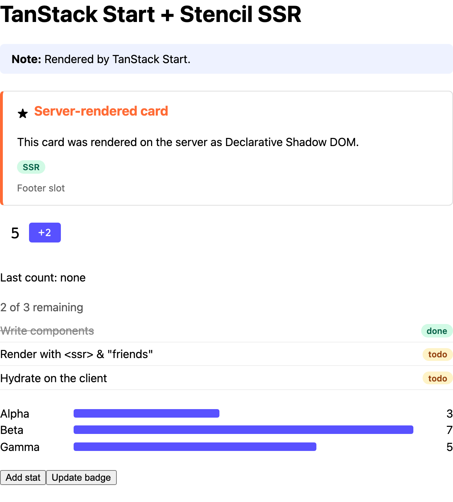
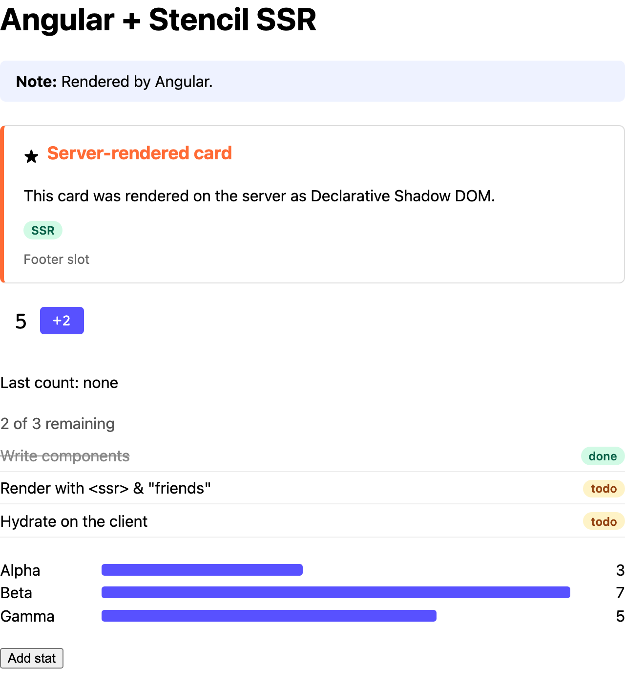
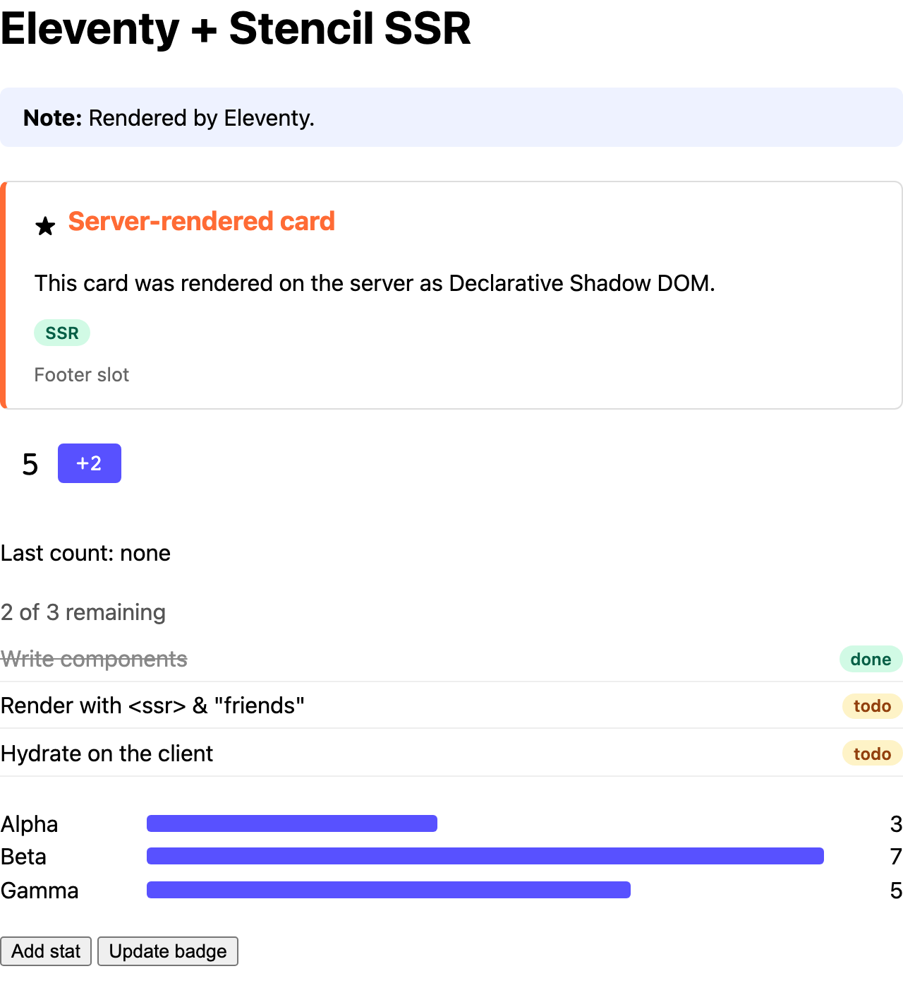

# Stencil SSR examples

Server-rendering [Stencil](https://stenciljs.com) components in JavaScript frameworks, with
Stencil's [`ssr` output target](https://stenciljs.com/docs/ssr). Each example builds the same
page with the same component library.

| Framework | Example | Where Stencil hooks in |
|---|---|---|
| Next.js (App Router) | [`examples/next`](examples/next) | the React output target's server wrappers |
| Nuxt | [`examples/nuxt`](examples/nuxt) | a Nitro `render:response` hook |
| Astro | [`examples/astro`](examples/astro) | middleware |
| SvelteKit | [`examples/sveltekit`](examples/sveltekit) | the `handle` hook |
| SolidStart | [`examples/solid-start`](examples/solid-start) | middleware |
| React Router (ex-Remix) | [`examples/react-router`](examples/react-router) | `entry.server.tsx` |
| TanStack Start | [`examples/tanstack-start`](examples/tanstack-start) | a custom server entry |
| Angular | [`examples/angular`](examples/angular) | `server.ts` |
| Eleventy | [`examples/eleventy`](examples/eleventy) | a transform, at build time |
| No framework | [`examples/node`](examples/node) | a plain Node server |

They need `@stencil/core` 5.0.0-beta.36 or later.

### Screenshots

Taken with JavaScript disabled, so each one is only the HTML the server sent: Declarative Shadow
DOM, styles and all. With JavaScript on, the framework and the components hydrate that same
markup.

| | |
|---|---|
| [](examples/next)<br>Next.js | [](examples/nuxt)<br>Nuxt |
| [](examples/astro)<br>Astro | [](examples/sveltekit)<br>SvelteKit |
| [](examples/solid-start)<br>SolidStart | [](examples/react-router)<br>React Router |
| [](examples/tanstack-start)<br>TanStack Start | [](examples/angular)<br>Angular |
| [](examples/eleventy)<br>Eleventy | [](examples/node)<br>No framework |

## Using a Stencil library in your framework

Three steps, the same in every framework except Next.js:

1. **Server:** find the one place that sees the finished HTML page, and pass it through the
   library's `renderToString()`:

   ```ts
   import { renderToString } from 'my-components/ssr';

   const { html } = await renderToString(page, { reuseWindow: true });
   ```

2. **Browser:** define the components *before* the framework hydrates the page, and wait for it:

   ```ts
   import { defineCustomElements } from 'my-components/loader';

   await defineCustomElements();
   // then let the framework hydrate
   ```

   Defined later, the framework finds Stencil's server-rendered markup where it expected its
   own, reports hydration mismatches, and re-renders the components.

3. **Objects and arrays:** wrap them in `ssrProp()` (see below).

Next.js renders components one at a time, so there's no whole page to pass through a hook. The
React output target's server wrappers render each component instead: see
[`examples/next`](examples/next).

### Passing objects and arrays

Frameworks write attributes, which are strings, so they leave objects and arrays out of the
server HTML. Wrap them in `ssrProp()`:

```vue
<script setup>
import { ssrProp } from 'my-components/ssr-prop';
</script>

<my-chart :data="ssrProp(data)" />
```

In the browser, `ssrProp()` returns the value as it is. On the server, it hands the value to
Stencil's render directly, so any value works: an array, a `Map`, a class instance. Bind it under
the prop's name (`chartData`) or its dash-case (`chart-data`).

Whether the component still has the value when it first renders in the browser is up to the
component (see below). If it can't keep it, `renderToString()` adds a warning to its
`diagnostics`.

## Writing a library for this

Add the `ssr` output target next to your client output, and let Stencil write the export map:

```ts
// stencil.config.ts
export const config: Config = {
  generateExportMaps: true, // ./loader, ./ssr, ./ssr-prop
  outputTargets: [{ type: 'loader-bundle' }, { type: 'ssr' }],
};
```

**Complex props:** the browser only gets the HTML, so a prop that takes an object or array has to
carry it in its attribute. For JSON, that's one option:

```tsx
@Prop({ serialize: 'json' }) data: ChartPoint[] = [];
```

The value is written to the attribute during server rendering and read back before the
component first renders in the browser. For other formats, such as a `Map` or a `Date`, write a
[`@PropSerialize()` / `@AttrDeserialize()`](https://stenciljs.com/docs/serialization) pair.

**Types for frameworks:** the [types output target](https://www.npmjs.com/package/@stencil/types-output-target)
generates template types for React, Vue, Svelte, Solid and Astro, so `<my-chart data={...} />`
is type-checked. Each app imports its file once (as these examples do), so add the
frameworks as optional `peerDependencies` of the library. Otherwise the types can't resolve
them and quietly check nothing.

**Vue and Angular wrappers:** set the output target's `ssrPropModule` to your `ssr-prop` module.
Neither framework's server render writes objects (or, in Angular, any property) into the HTML,
so without it the wrappers' props never reach `renderToString()`. See
[`examples/nuxt`](examples/nuxt) and [`examples/angular`](examples/angular).

**Slots, if your users use Svelte:** Svelte 5 can't hydrate slotted content that can change in a
`scoped` or unencapsulated component, so use `shadow` encapsulation for components that take
it. See [`examples/sveltekit`](examples/sveltekit).

The component library these examples use is [`packages/components`](packages/components).

## Working on this repo

Needs Node 22+ (24 for SolidStart) and pnpm 9.

```sh
pnpm install
pnpm build                       # the component library and its React, Vue and Angular wrappers
scripts/test-all.sh              # build, start and test every example
DEV=1 scripts/test-all.sh nuxt   # one example, on its dev server
node scripts/screenshots.mjs     # the README screenshots (build first)
```

Every example renders the page in [`CONTRACT.md`](CONTRACT.md), and
[`tests/conformance`](tests/conformance) checks it: the server HTML, the page with JavaScript off,
and hydration (no errors or mismatches, nothing replaced or duplicated, and both the components
and the framework still work).
