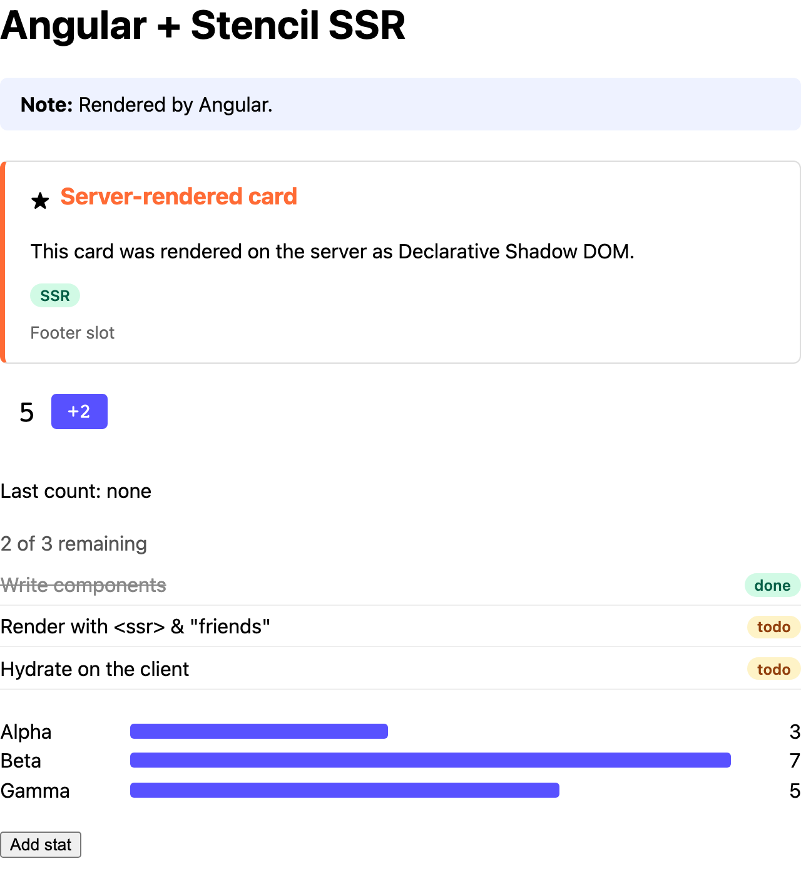

# Angular

Server-rendering Stencil components in an Angular app with `@angular/ssr`.



<sub>The server's HTML, with JavaScript off.</sub>

```sh
pnpm install && pnpm build   # at the repo root, once
pnpm dev                     # in this folder: http://localhost:3007
```

## 1. Render the components on the server

`AngularNodeAppEngine.handle()` returns the finished page as a `Response`. Pass HTML responses
through `renderToString()` before sending them ([`src/server.ts`](src/server.ts); `ng serve` uses
the same file):

```ts
import { renderToString } from '@ssr-examples/components/ssr';

async function renderStencil(response: Response): Promise<Response> {
  if (!response.headers.get('content-type')?.includes('text/html')) return response;
  const page = await response.text();
  const { html, diagnostics } = await renderToString(page, { reuseWindow: true });
  for (const d of diagnostics) console.warn('[stencil]', d.messageText);
  const headers = new Headers(response.headers);
  headers.delete('content-length');
  return new Response(html || page, { status: response.status, statusText: response.statusText, headers });
}

app.use(async (req, res, next) => {
  try {
    const response = await angularApp.handle(req);
    if (!response) return next();
    await writeResponseToNodeResponse(await renderStencil(response), res);
  } catch (err) {
    next(err);
  }
});
```

## 2. Define the components before Angular hydrates

Bootstrap once `defineCustomElements()` has finished ([`src/main.ts`](src/main.ts)):

```ts
import { defineCustomElements } from '@ssr-examples/components/loader';

defineCustomElements()
  .then(() => bootstrapApplication(App, appConfig))
  .catch((err) => console.error(err));
```

Defined later, Angular finds Stencil's markup where it expects its own text nodes and fails to
bootstrap, so events and bindings stop working. (`ngSkipHydration` hides this only by
re-rendering the components.)

## 3. Use the components

Add `CUSTOM_ELEMENTS_SCHEMA` to the component, then use them in the template
([`src/app/app.ts`](src/app/app.ts)):

```ts
import { ssrProp } from '@ssr-examples/components/ssr-prop';

@Component({
  schemas: [CUSTOM_ELEMENTS_SCHEMA],
  template: `
    <demo-counter start="5" step="2" (countChanged)="lastCount.set($event.detail)"></demo-counter>
    <demo-stats [attr.stats]="ssrAttr(stats())" [stats]="stats()"></demo-stats>
  `,
})
export class App {
  private readonly isServer = isPlatformServer(inject(PLATFORM_ID));

  protected ssrAttr(value: unknown) {
    return this.isServer ? ssrProp(value) : null;
  }
}
```

- **Objects and arrays:** Angular's server render drops `[stats]` property bindings, so bind
  `[attr.stats]` to `ssrProp()` on the server (`ssrAttr()` returns `null` in the browser, leaving
  the attribute off), plus `[stats]` for the browser. Don't bind `[attr.stats]="ssrProp(...)"`
  alone: in the browser it writes `[object Object]`. See
  [Passing objects and arrays](../../README.md#passing-objects-and-arrays).
- **Events:** `(countChanged)` listens for `countChanged`, exactly as written.
- **Render mode:** Angular prerenders at build time by default, and a prerendered file served
  directly (CDN, static hosting) has no Stencil markup. Use `RenderMode.Server`
  ([`src/app/app.config.server.ts`](src/app/app.config.server.ts)).
- **Allowed hosts:** Angular answers requests for unlisted hosts with `400`. Add yours to
  `security.allowedHosts` in [`angular.json`](angular.json).
