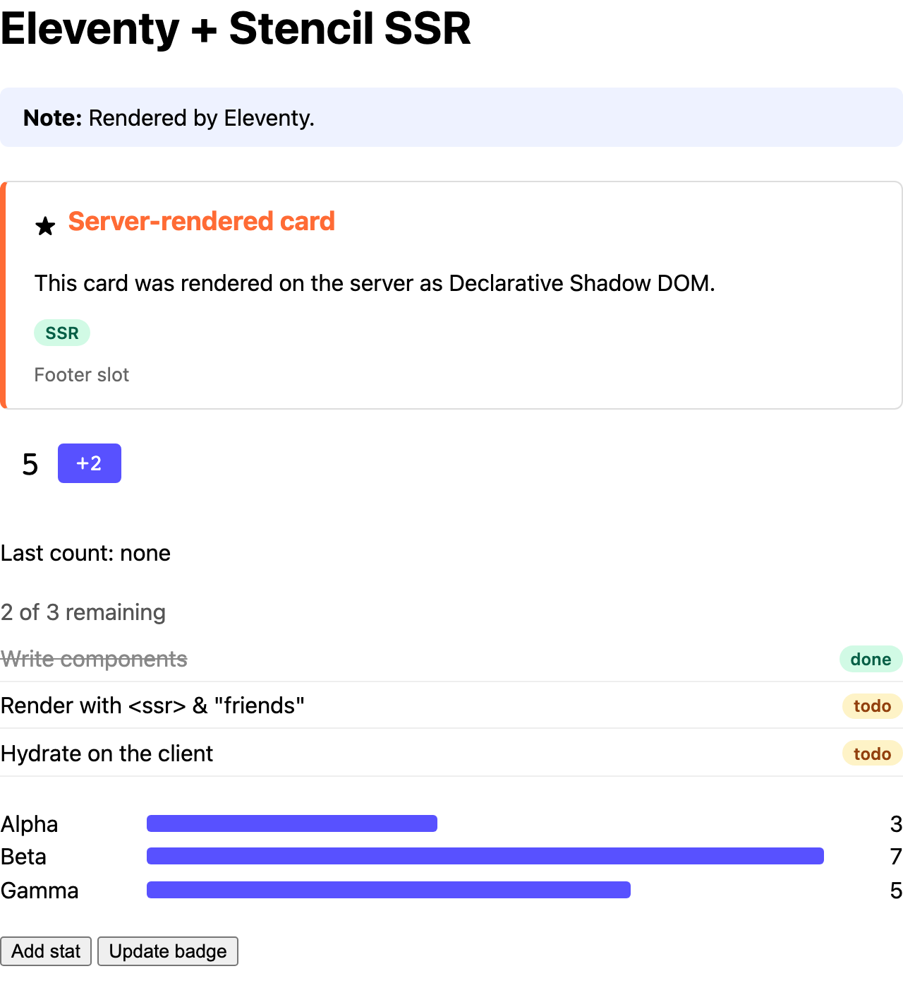

# Eleventy

Server-rendering Stencil components into an Eleventy site, at build time.



<sub>The built HTML, with JavaScript off.</sub>

```sh
pnpm install && pnpm build   # at the repo root, once
pnpm dev                     # in this folder: http://localhost:3009
```

Everything is in [`eleventy.config.js`](eleventy.config.js) and [`src/index.njk`](src/index.njk).

## 1. Render the components at build time

A transform receives each page Eleventy writes. Pass it through `renderToString()`:

```js
import { renderToString } from '@ssr-examples/components/ssr';

eleventyConfig.addTransform('stencil-ssr', async function (content) {
  if (!this.page.outputPath?.endsWith('.html')) return content;
  const { html, diagnostics } = await renderToString(content, { reuseWindow: true });
  for (const d of diagnostics) console.warn('[stencil]', d.messageText);
  return html ?? content;
});
```

## 2. Load the components in the browser

Copy the library's browser build into the site, and load it with a `<script>` tag:

```js
eleventyConfig.addPassthroughCopy({
  'node_modules/@ssr-examples/components/dist/loader-bundle/demo-components': 'demo-components',
});
```

```html
<script type="module" src="/demo-components/demo-components.esm.js"></script>
```

There's no framework to hydrate, so the components can define themselves whenever the script
runs.

## 3. Use the components

Write them like any element. For objects and arrays, add `ssrProp()` as a filter:

```js
import { ssrProp } from '@ssr-examples/components/ssr-prop';

eleventyConfig.addFilter('ssrProp', ssrProp);
```

```njk
<demo-counter start="5" step="2"></demo-counter>
<demo-stats stats="{{ stats | ssrProp }}"></demo-stats>
```

Listen for events and set properties from a script in the page
([`src/client.js`](src/client.js)). See
[Passing objects and arrays](../../README.md#passing-objects-and-arrays).
