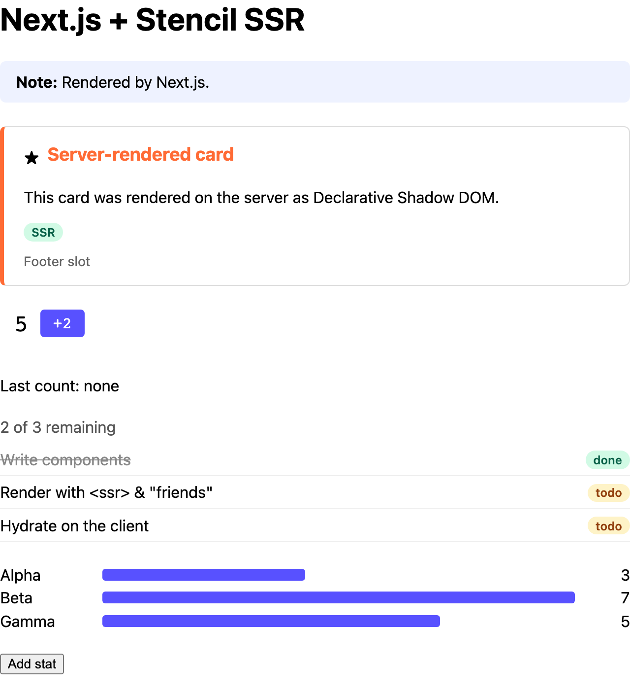

# Next.js

Server-rendering Stencil components in a Next.js (App Router) app.



<sub>The server's HTML, with JavaScript off.</sub>

Next.js renders components one at a time, so there's no finished page to pass through
`renderToString()`. Instead, the [React output target](https://stenciljs.com/docs/react#server-side-rendering)
generates React wrappers that render their Stencil component on the server.

```sh
pnpm install && pnpm build   # at the repo root, once
pnpm dev                     # in this folder: http://localhost:3001
```

## 1. Generate the wrappers

In the component library, point the React output target at the `ssr` module
([`packages/components/stencil.config.ts`](../../packages/components/stencil.config.ts)):

```ts
outputTargets: [
  { type: 'ssr' },
  reactOutputTarget({
    outDir: '../components-react/src',
    hydrateModule: '@ssr-examples/components/ssr',
    clientModule: '@ssr-examples/components-react',
  }),
],
```

This generates the usual wrappers plus a server version. Export the server version as `./next`
from the React package ([`packages/components-react/package.json`](../../packages/components-react/package.json)).

## 2. Use the wrappers from `/next`

Import components from `/next` ([`app/demo.tsx`](app/demo.tsx)). On the server they render the
Stencil component; in the browser they're the normal wrappers.

```tsx
'use client';
import { DemoCounter, DemoStats } from '@ssr-examples/components-react/next';

<DemoCounter start={5} step={2} onCountChanged={(e) => setLastCount(e.detail)} />
<DemoStats stats={stats} />
```

- **Objects and arrays:** pass them as props, nothing else needed. For the component to have the
  value when it first renders in the browser, the prop needs a serializer, such as
  `@Prop({ serialize: 'json' })`: see [Writing a library for this](../../README.md#writing-a-library-for-this).
- **Text next to a value:** React separates `Last count: {n}` into two text nodes with a
  `<!-- -->` between them. Use one string, `` {`Last count: ${n}`} ``, for text slotted into a
  `scoped` or unencapsulated component.
- Needs `@stencil/react-output-target` 1.8.1 or later.
