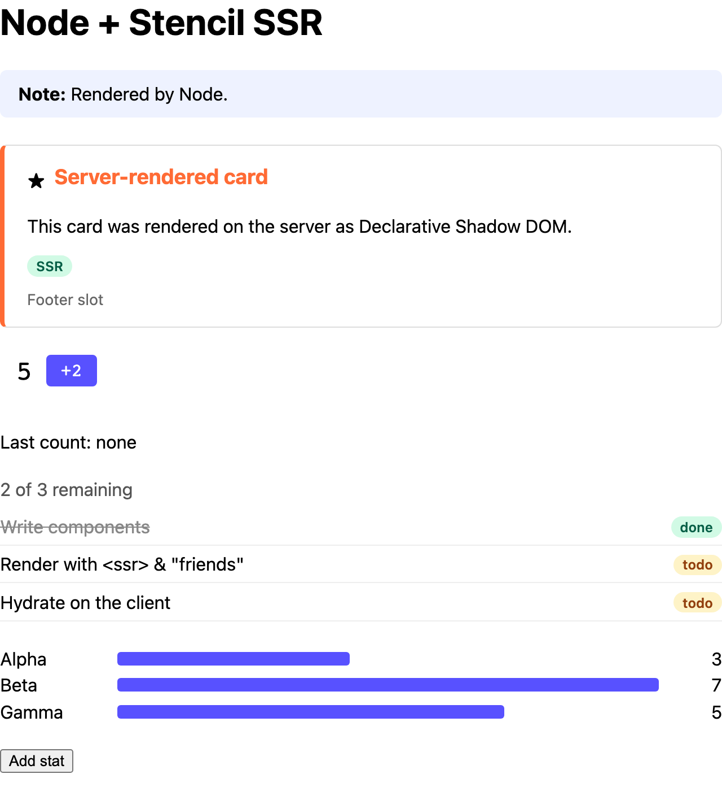

# No framework

Server-rendering Stencil components from a plain Node server: the starting point for Express,
Hono, Fastify or any other server that builds HTML itself.



<sub>The server's HTML, with JavaScript off.</sub>

```sh
pnpm install && pnpm build   # at the repo root, once
pnpm dev                     # in this folder: http://localhost:3000
```

Everything is in [`server.js`](server.js).

## 1. Render the components on the server

Pass the finished page through `renderToString()` before sending it:

```js
import { renderToString } from '@ssr-examples/components/ssr';

const { html } = await renderToString(page(), { reuseWindow: true });
res.end(html);
```

## 2. Load the components in the browser

Serve the library's client code and define the components:

```js
import { defineCustomElements } from '/stencil/loader.js';
defineCustomElements();
```

## Passing objects and arrays

Wrap the value in `ssrProp()` and escape it like any other attribute:

```js
import { ssrProp } from '@ssr-examples/components/ssr-prop';

`<demo-stats stats="${attr(ssrProp(stats))}"></demo-stats>`
```

See [Passing objects and arrays](../../README.md#passing-objects-and-arrays).
