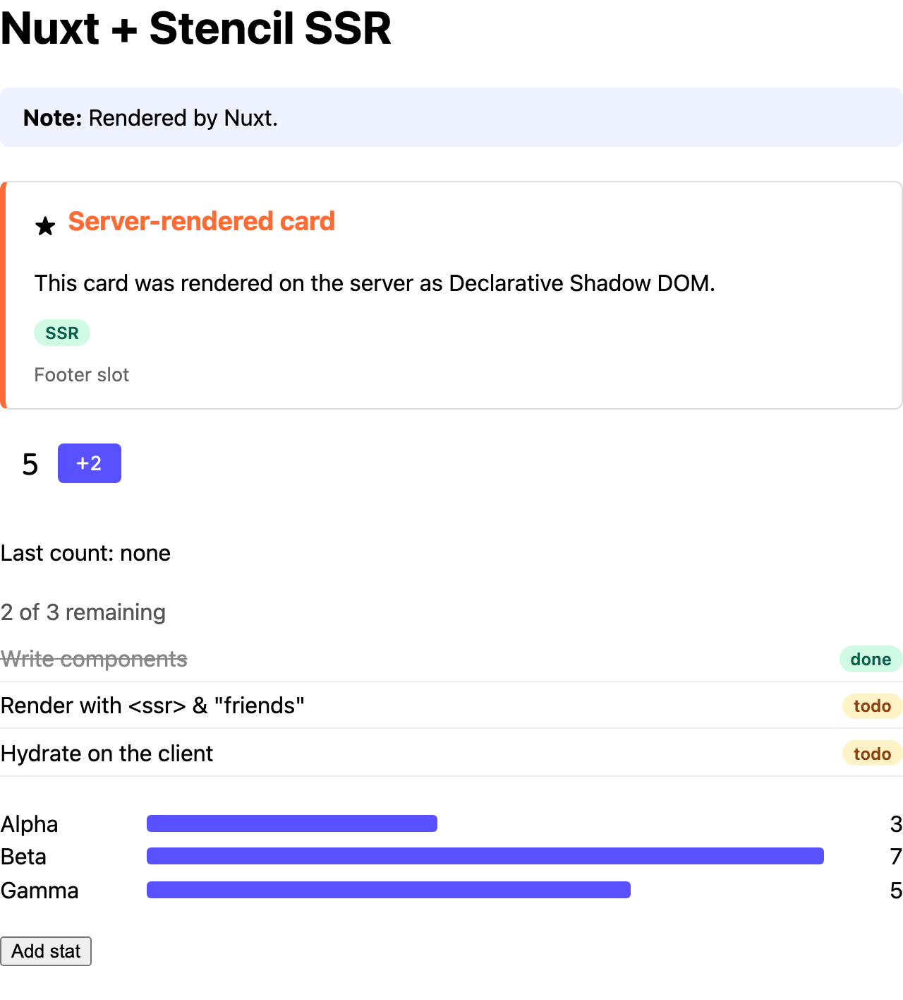

# Nuxt

Server-rendering Stencil components in a Nuxt app.



<sub>The server's HTML, with JavaScript off.</sub>

```sh
pnpm install && pnpm build   # at the repo root, once
pnpm dev                     # in this folder: http://localhost:3002
```

## 1. Render the components on the server

Nitro's `render:response` hook receives the finished page. Pass it through `renderToString()`
([`server/plugins/stencil-ssr.ts`](server/plugins/stencil-ssr.ts)):

```ts
import { renderToString } from '@ssr-examples/components/ssr';

export default defineNitroPlugin((nitroApp) => {
  nitroApp.hooks.hook('render:response', async (response) => {
    if (typeof response.body !== 'string' || !response.headers?.['content-type']?.includes('text/html')) {
      return;
    }
    const { html, diagnostics } = await renderToString(response.body, { reuseWindow: true });
    for (const d of diagnostics) console.warn('[stencil]', d.messageText);
    if (html) response.body = html;
  });
});
```

## 2. Use the components

Use the library's Vue wrappers, `@ssr-examples/components-vue`, like any Vue component
([`app/app.vue`](app/app.vue)):

```vue
<script setup lang="ts">
import { DemoCounter, DemoStats } from '@ssr-examples/components-vue';
</script>

<template>
  <DemoCounter :start="5" :step="2" @countChanged="lastCount = $event.detail" />
  <DemoStats :stats="stats" />
</template>
```

- **Defining the components:** each wrapper defines its element when it's imported, so before
  Vue hydrates. Nothing else to set up.
- **Objects and arrays:** bind them like any prop. On the server, the wrappers hand them to
  `renderToString()` through `ssrProp()` (the library sets this up, see below).
- **Events:** `@countChanged` listens for `countChanged`, exactly as written.

## Without the wrappers

The wrappers are optional: the components also work as plain custom elements, with no Vue output
target. Then:

1. Tell Vue they're custom elements, in [`nuxt.config.ts`](nuxt.config.ts):

   ```ts
   vue: { compilerOptions: { isCustomElement: (tag) => tag.startsWith('demo-') } },
   ```

2. Define them before Vue hydrates, in a `.client` plugin (Nuxt waits for an async one):

   ```ts
   // app/plugins/stencil.client.ts
   import { defineCustomElements } from '@ssr-examples/components/loader';

   export default defineNuxtPlugin(async () => {
     await defineCustomElements();
   });
   ```

3. Wrap objects and arrays in `ssrProp()`, or Vue leaves them out of the server HTML:

   ```vue
   <script setup lang="ts">
   import { ssrProp } from '@ssr-examples/components/ssr-prop';
   </script>

   <template>
     <demo-counter :start="5" :step="2" @countChanged="lastCount = $event.detail" />
     <demo-stats :stats="ssrProp(stats)" />
   </template>
   ```

For type-checked templates, import the types the library generates for Vue (from the
[types output target](https://www.npmjs.com/package/@stencil/types-output-target)) once:

```ts
// app/custom-elements.d.ts
import '@ssr-examples/components/vue-native-types';
```

## For the library author

The wrappers come from the Vue output target. Vue's server renderer drops objects, and writes
props under the names they're bound with (`firstName` would reach the HTML as `firstname`), so set
`ssrPropModule`: on the server, the wrappers then write each prop under its attribute name
([`packages/components/stencil.config.ts`](../../packages/components/stencil.config.ts)):

```ts
vueOutputTarget({
  componentCorePackage: '@ssr-examples/components',
  proxiesFile: '../components-vue/src/components.ts',
  includeImportCustomElements: true,
  ssrPropModule: '@ssr-examples/components/ssr-prop',
}),
```
