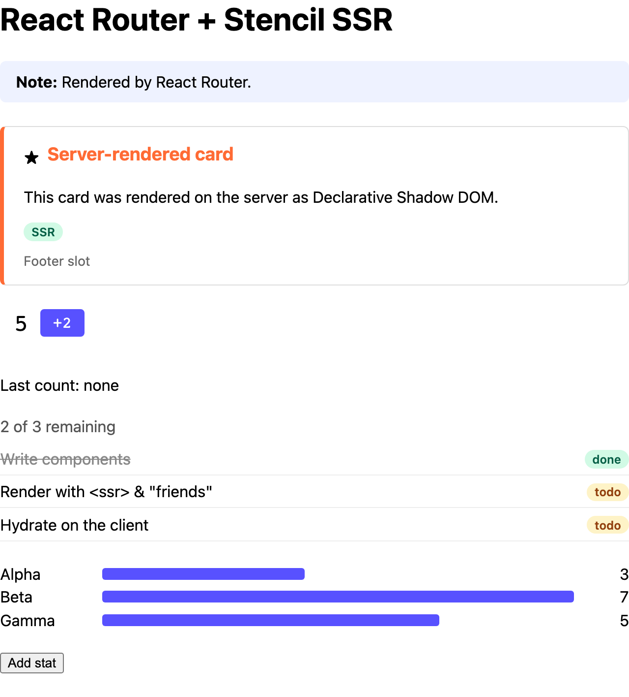

# React Router

Server-rendering Stencil components in a React Router (framework mode) app.



<sub>The server's HTML, with JavaScript off.</sub>

```sh
pnpm install && pnpm build   # at the repo root, once
pnpm dev                     # in this folder: http://localhost:3006
```

## 1. Render the components on the server

`handleRequest` in `entry.server.tsx` is the one place that sees the whole page, but React streams
it. Wait for `onAllReady`, buffer the stream, and pass it through `renderToString()`
([`app/entry.server.tsx`](app/entry.server.tsx); run `npx react-router reveal` to get the default
file to start from):

```tsx
import { renderToString } from '@ssr-examples/components/ssr';

const { pipe, abort } = renderToPipeableStream(<ServerRouter context={routerContext} url={request.url} />, {
  onAllReady() {
    const chunks: Buffer[] = [];
    const body = new PassThrough();
    body.on('data', (chunk: Buffer) => chunks.push(chunk));
    body.on('end', async () => {
      const { html, diagnostics } = await renderToString(Buffer.concat(chunks).toString('utf8'), { reuseWindow: true });
      for (const d of diagnostics) console.warn('[stencil]', d.messageText);
      responseHeaders.set('Content-Type', 'text/html; charset=utf-8');
      resolve(new Response(html, { headers: responseHeaders, status: responseStatusCode }));
    });
    pipe(body);
  },
  // onShellError, onError ...
});
```

## 2. Define the components before React hydrates

Wait for `defineCustomElements()`, then call `hydrateRoot()`
([`app/entry.client.tsx`](app/entry.client.tsx)):

```tsx
import { defineCustomElements } from '@ssr-examples/components/loader';

defineCustomElements().then(() => {
  startTransition(() => {
    hydrateRoot(document, <StrictMode><HydratedRouter /></StrictMode>);
  });
});
```

Otherwise React finds Stencil's markup where it expects its own, throws a hydration error and
re-renders the whole document.

## 3. Use the components

Use them as plain custom elements. Add JSX types for the tags
([`app/custom-elements.d.ts`](app/custom-elements.d.ts)), and put `suppressHydrationWarning` on
`<html>` ([`app/root.tsx`](app/root.tsx)). Then ([`app/routes/home.tsx`](app/routes/home.tsx)):

```tsx
import { ssrProp } from '@ssr-examples/components/ssr-prop';

const counterRef = useCallback((el: HTMLElement | null) => {
  if (!el) return;
  const onCountChanged = (e: Event) => setLastCount((e as CustomEvent<number>).detail);
  el.addEventListener('countChanged', onCountChanged);
  return () => el.removeEventListener('countChanged', onCountChanged);
}, []);

<demo-counter suppressHydrationWarning start="5" step="2" ref={counterRef} />
<demo-stats suppressHydrationWarning stats={ssrProp(stats)} />
```

- **Objects and arrays:** wrap them in `ssrProp()`, or React leaves them out of the server HTML.
  React 19 also doesn't set properties on elements it hydrates, so the first render relies on
  this; later updates work normally. See
  [Passing objects and arrays](../../README.md#passing-objects-and-arrays).
- **Events:** React 19 doesn't attach `on*` listeners to custom elements it hydrates, so listen
  from a ref, as above.
- **`suppressHydrationWarning`** on every component host: Stencil adds attributes React didn't
  render, which React's dev build reports as mismatches. Production builds don't check, so test
  in `dev` too.
- **Text:** React splits `Last count: {n}` into two text nodes with `<!-- -->` between them. Use
  one string (`` {`Last count: ${n}`} ``) when the exact text matters.
- **Styles:** load page CSS with a `<link>` (the `links` export), not a plain `<style>` in
  `<head>`; React would hydrate it against one of Stencil's.
- **No streaming:** the first byte waits for the whole page, including Suspense data.
