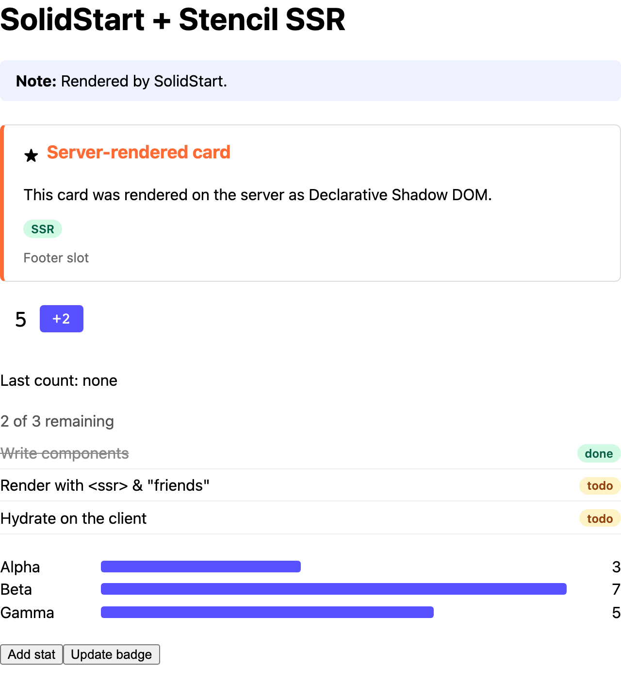

# SolidStart

Server-rendering Stencil components in a SolidStart app.



<sub>The server's HTML, with JavaScript off.</sub>

```sh
pnpm install && pnpm build   # at the repo root, once
pnpm dev                     # in this folder: http://localhost:3005
```

## 1. Render the components on the server

Render the page as one string instead of streaming it, with `mode: 'async'`
([`src/entry-server.tsx`](src/entry-server.tsx)). Then a middleware passes it through
`renderToString()` ([`src/middleware.ts`](src/middleware.ts)):

```ts
import { createMiddleware } from '@solidjs/start/middleware';
import { renderToString } from '@ssr-examples/components/ssr';

export default createMiddleware([
  async (event, next) => {
    const body = await next();
    if (typeof body !== 'string' || !event.res.headers.get('content-type')?.includes('text/html')) {
      return body;
    }
    const { html, diagnostics } = await renderToString(body, { reuseWindow: true });
    for (const d of diagnostics) console.warn('[stencil]', d.messageText);
    return html ?? body;
  },
]);
```

Register it with `solidStart({ middleware: './src/middleware.ts' })` in
[`vite.config.ts`](vite.config.ts).

## 2. Define the components before Solid hydrates

Mount once `defineCustomElements()` resolves ([`src/entry-client.tsx`](src/entry-client.tsx)):

```tsx
import { mount, StartClient } from '@solidjs/start/client';
import { defineCustomElements } from '@ssr-examples/components/loader';

defineCustomElements().then(() => mount(() => <StartClient />, document.getElementById('app')!));
```

Don't define them later, such as in `onMount`: Solid would fail with a hydration mismatch and
throw the server-rendered page away.

## 3. Use the components

Import the JSX types the library generates for Solid
([`src/custom-elements.d.ts`](src/custom-elements.d.ts)), then use them like any element ([`src/routes/index.tsx`](src/routes/index.tsx)):

```tsx
import { ssrProp } from '@ssr-examples/components/ssr-prop';

<demo-counter start={5} step={2} on:countChanged={(e) => setLastCount(e.detail)} />
<demo-stats stats={ssrProp(stats())} />
```

- **Objects and arrays:** wrap them in `ssrProp()`, or Solid leaves them out of the server HTML.
  In the browser it returns the value as it is. See
  [Passing objects and arrays](../../README.md#passing-objects-and-arrays).
- **Events:** write `on:countChanged`. `onCountChanged` listens for `countchanged`, which never
  fires.
- **No `prop:`:** Solid's server renderer drops `prop:` bindings, so the server HTML gets no
  value. A plain binding is already set as a property in the browser.
