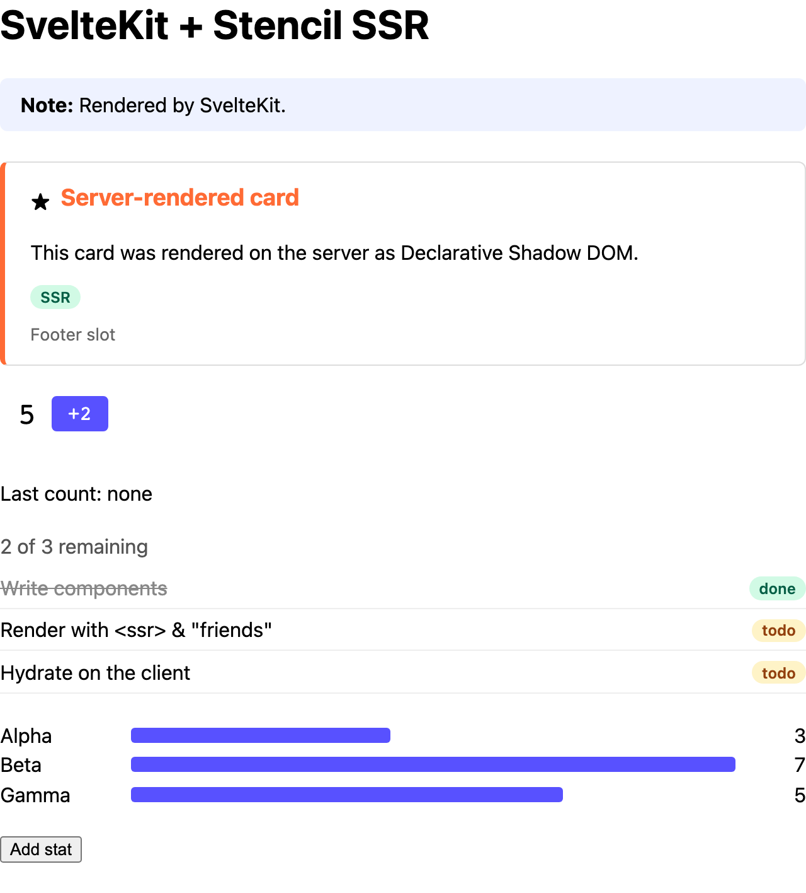

# SvelteKit

Server-rendering Stencil components in a SvelteKit app.



<sub>The server's HTML, with JavaScript off.</sub>

```sh
pnpm install && pnpm build   # at the repo root, once
pnpm dev                     # in this folder: http://localhost:3004
```

## 1. Render the components on the server

The `handle` hook receives the page as a `Response`. Read the whole body, pass it through
`renderToString()` and return a new `Response` ([`src/hooks.server.ts`](src/hooks.server.ts)):

```ts
import type { Handle } from '@sveltejs/kit/hooks';
import { renderToString } from '@ssr-examples/components/ssr';

export const handle: Handle = async ({ event, resolve }) => {
  const response = await resolve(event);
  if (!response.headers.get('content-type')?.includes('text/html')) {
    return response;
  }
  const { html, diagnostics } = await renderToString(await response.text(), { reuseWindow: true });
  for (const d of diagnostics) console.warn('[stencil]', d.messageText);
  const headers = new Headers(response.headers);
  headers.delete('content-length');
  return new Response(html, { status: response.status, statusText: response.statusText, headers });
};
```

Don't use `transformPageChunk` for this: its chunks aren't guaranteed to be whole documents.

## 2. Define the components before Svelte hydrates

SvelteKit waits for the client `init` hook before hydrating
([`src/hooks.client.ts`](src/hooks.client.ts)):

```ts
import type { ClientInit } from '@sveltejs/kit/hooks';
import { defineCustomElements } from '@ssr-examples/components/loader';

export const init: ClientInit = async () => {
  await defineCustomElements();
};
```

Don't define them later, such as in `onMount`: Svelte would throw or report hydration mismatches
and re-render the whole page.

## 3. Use the components

Use them like any element ([`src/routes/+page.svelte`](src/routes/+page.svelte)):

```svelte
<script lang="ts">
  import { ssrProp } from '@ssr-examples/components/ssr-prop';
</script>

<demo-counter start="5" step="2" oncountChanged={(e: CustomEvent<number>) => (lastCount = e.detail)}
></demo-counter>
<demo-stats stats={ssrProp(stats)}></demo-stats>
```

- **Objects and arrays:** wrap them in `ssrProp()`, or Svelte leaves them out of the server HTML.
  In the browser it returns the value as it is. See
  [Passing objects and arrays](../../README.md#passing-objects-and-arrays).
- **Events:** `oncountChanged` listens for `countChanged`, exactly as written after `on`.
- **Reactive slotted text:** Svelte 5 can't hydrate reactive text slotted into `scoped` or
  unencapsulated components, and re-renders the page. Use `shadow` encapsulation for components
  that take reactive slot content.
