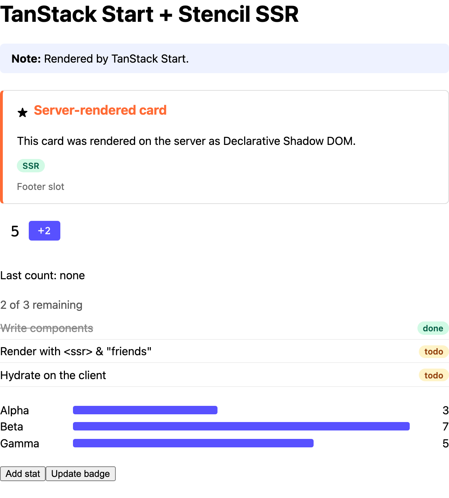

# TanStack Start

Server-rendering Stencil components in a TanStack Start app.



<sub>The server's HTML, with JavaScript off.</sub>

```sh
pnpm install && pnpm build   # at the repo root, once
pnpm dev                     # in this folder: http://localhost:3008
```

## 1. Render the components on the server

A `src/server.ts` replaces Start's default server entry. Render each page as one string with
`defaultRenderHandler` instead of streaming it, then pass it through `renderToString()`
([`src/server.ts`](src/server.ts)):

```ts
import { createServerEntry, createStartHandler, defaultRenderHandler } from '@tanstack/react-start/server';
import { renderToString } from '@ssr-examples/components/ssr';

const startHandler = createStartHandler(defaultRenderHandler);

export default createServerEntry({
  async fetch(request) {
    const response = await startHandler(request);
    if (!response.headers.get('content-type')?.includes('text/html')) return response;

    const { html, diagnostics } = await renderToString(await response.text(), { reuseWindow: true });
    for (const d of diagnostics) console.warn('[stencil]', d.messageText);

    const headers = new Headers(response.headers);
    headers.delete('content-length');
    return new Response(html, { status: response.status, headers });
  },
});
```

## 2. Define the components before React hydrates

A `src/client.tsx` replaces the default client entry. Wait for `defineCustomElements()`, then
call `hydrateRoot()` ([`src/client.tsx`](src/client.tsx)):

```tsx
import { defineCustomElements } from '@ssr-examples/components/loader';

defineCustomElements().then(() => {
  startTransition(() => {
    hydrateRoot(document, <StrictMode><StartClient /></StrictMode>);
  });
});
```

Otherwise React finds Stencil's markup where it expects its own, throws a hydration error and
re-renders the whole document.

## 3. Use the components

Use them as plain custom elements. Import the JSX types the library generates for React
([`src/custom-elements.d.ts`](src/custom-elements.d.ts)), and put `suppressHydrationWarning` on
`<html>` ([`src/routes/__root.tsx`](src/routes/__root.tsx)). Then
([`src/routes/index.tsx`](src/routes/index.tsx)):

```tsx
import { ssrProp } from '@ssr-examples/components/ssr-prop';

const counterRef = useCallback((el: HTMLElement | null) => {
  if (!el) return;
  const onCountChanged = (e: Event) => setLastCount((e as CustomEvent<number>).detail);
  el.addEventListener('countChanged', onCountChanged);
  return () => el.removeEventListener('countChanged', onCountChanged);
}, []);

<demo-counter suppressHydrationWarning start={5} step={2} ref={counterRef} />
<demo-stats suppressHydrationWarning stats={ssrProp(stats)} />
```

The React specifics are the same as in React Router:

- **Objects and arrays:** wrap them in `ssrProp()`, or React leaves them out of the server HTML.
  React 19 also doesn't set properties on elements it hydrates, so the first render relies on
  this; later updates work normally. See
  [Passing objects and arrays](../../README.md#passing-objects-and-arrays).
- **Events:** React 19 doesn't attach `on*` listeners to custom elements it hydrates, so listen
  from a ref, as above.
- **`suppressHydrationWarning`** on every component host: Stencil adds attributes React didn't
  render, which React's dev build reports as mismatches.
- **Styles:** load page CSS with a `<link>` (the route's `head`), not a plain `<style>` in
  `<head>`; React would hydrate it against one of Stencil's.
- **No streaming:** the first byte waits for the whole page.
